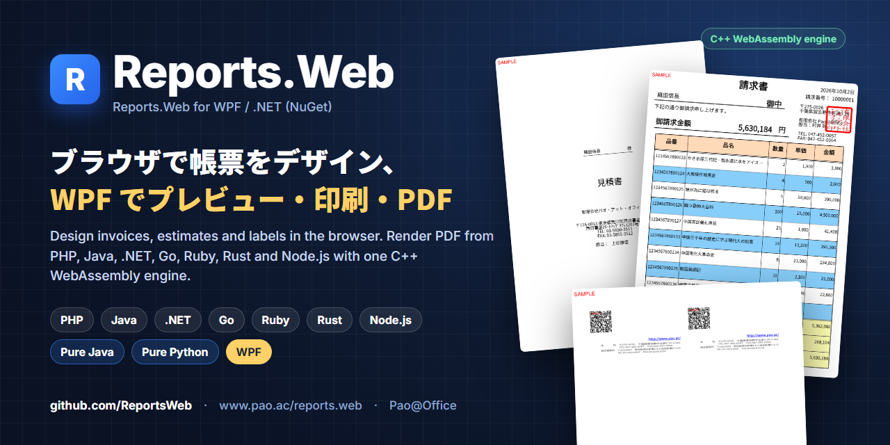
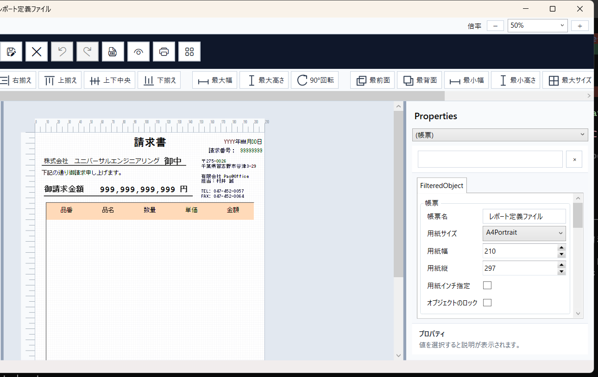
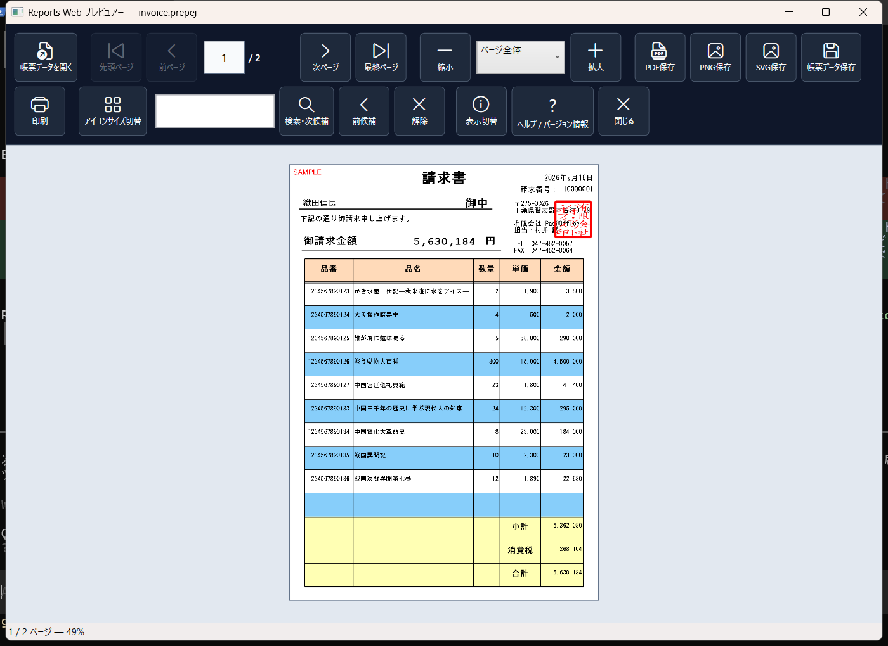
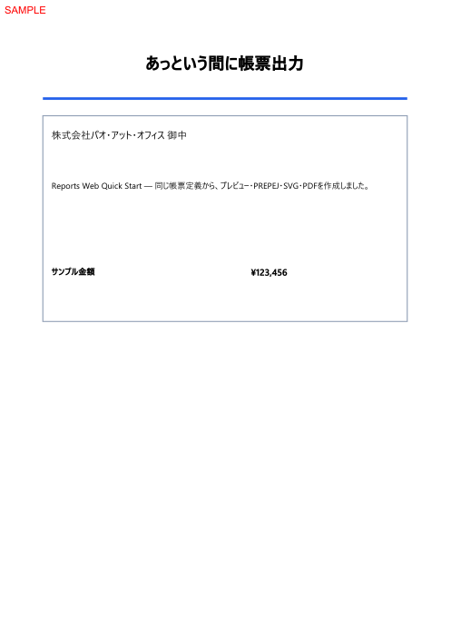

<p align="center"></p>

# Reports.Web — WPF / .NET サンプル

[](https://www.nuget.org/packages/Reports.Web.Wpf)
[](https://www.pao.ac/reports.web/)

**Reports.Web** は、帳票をデザインして、いろいろな言語から PDF を作る帳票ツールです。このリポジトリは、**WPF / .NET（Windows）** から使うサンプル（製品の配布 ZIP に入っているものと同じ）です。

帳票定義（`.prepdj`）を読み込んで値を入れ、WPF の画面でプレビュー・印刷し、PDF・SVG・PNG・印刷データ（PREPEJ）に出力します。請求書・見積書・納品書・郵便番号一覧・名刺など、日本の業務帳票向けです。帳票エンジンは NuGet パッケージ [`Reports.Web.Wpf`](https://www.nuget.org/packages/Reports.Web.Wpf) として、ビルド時に自動で取得されます。

- 製品サイト：https://www.pao.ac/reports.web/
- NuGet パッケージ：[`Reports.Web.Wpf`](https://www.nuget.org/packages/Reports.Web.Wpf)（.NET 10 / .NET Framework 4.7.2）
- プログラマーズガイド：https://www.pao.ac/reports.web/manual/programmers/wpf-dotnet/

| WPF デザイナー（製品に同梱） | WPF プレビュー |
|---|---|
|  |  |

## サンプルを選ぶ

| # | フォルダー | 内容 |
|:-:|---|---|
| 01 | [01.あっという間に帳票出力](01.あっという間に帳票出力/README.md) | 最小の C# コードで 1 ページをプレビュー・PDF 保存（[.NET Framework 4.7.2 版](01.あっという間に帳票出力/Compat-net472/README.md)もあり） |
| 02 | [02.全帳票をパソコンでプレビュー](02.全帳票をパソコンでプレビュー/README.md) | SQLite の業務データから全帳票を作り、WPF の印刷プレビューで表示 |
| 03 | [03.全帳票をWebでプレビュー](03.全帳票をWebでプレビュー/README.md) | .NET のサーバーが SVG／PDF を作り、ブラウザーで表示 |
| 04 | [04.Web API・デスクトップ連携](04.Web%20API・デスクトップ連携/README.md) | API から印刷データ（PREPEJ）を受け取り、デスクトップでプレビュー・保存・PDF 化 |

## 必要な環境

- Windows 10 / 11（WPF のため Windows 専用）
- .NET 10 SDK（01 の互換版は .NET Framework 4.7.2）
- Visual Studio 2026（.NET デスクトップ開発・ASP.NET と Web 開発）、または VS Code・Cursor・コマンドライン
- 初回の NuGet 復元に使うインターネット接続

Docker、Node.js、PostgreSQL は不要です。02・03・04 の Server は、`common/database/sample.db`（SQLite）を読みます。

## クイックスタート

```powershell
git clone https://github.com/ReportsWeb/wpf.git
cd "wpf/01.あっという間に帳票出力"
dotnet run --project Pao.Reports.Wpf.QuickStart.csproj
```

Visual Studio なら、番号フォルダーの `.csproj` をダブルクリックして開き、F5 で実行します。04 だけは Server と Client を別々に開きます。

## コードの要点

```csharp
// 01: QuickStartReport.cs（抜粋）— 帳票定義を読み込み、値を入れて PDF とプレビュー
report.SavePdf(Path.Combine(outputDirectory, "quick-start.pdf"));
```



## 体験版と製品版

NuGet パッケージは**体験版**で、出力には赤い「SAMPLE」の印が付きます。ご購入後に納品するライセンスファイル（`reports-web.license`）を案内された場所に置くと印が消えます（パッケージの入れ替えは不要）。開発用パソコン 1 台につき 1 ライセンス、運用環境はランタイムライセンスフリーです。

- ご購入・お見積もり：https://www.pao.ac/reports.web/buy.html
- 使用許諾：https://www.pao.ac/reports.web/manual/index.html#16
- 帳票のデザインに使う WPF デザイナーは、製品の[体験版 ZIP](https://www.pao.ac/reports.web/index.html#download)に同梱しています。

このリポジトリのサンプルコードは [MIT License](LICENSE) です。NuGet パッケージには Reports.Web の使用許諾が適用されます。

## ほかの言語

同じ帳票定義・印刷データを、PHP・Java・.NET・Go・Ruby・Rust・Node.js（WASM 版）と Pure Java からも使えます。→ https://github.com/ReportsWeb

---

## English

**Reports.Web** is a report designer and PDF engine. This repository contains the **WPF / .NET (Windows)** samples shipped in the product ZIP: load a report definition (`.prepdj`), fill values, preview and print in a WPF window, and export PDF, SVG, PNG or print data (PREPEJ). Built for Japanese business forms (invoices, estimates, delivery slips, postal lists, business cards).

- Package: [`Reports.Web.Wpf`](https://www.nuget.org/packages/Reports.Web.Wpf) on NuGet (.NET 10 and .NET Framework 4.7.2), restored automatically.
- Requirements: Windows 10/11, .NET 10 SDK, Visual Studio or the dotnet CLI.

```powershell
git clone https://github.com/ReportsWeb/wpf.git
cd "wpf/01.あっという間に帳票出力"
dotnet run --project Pao.Reports.Wpf.QuickStart.csproj
```

The package is a trial build: output carries a red "SAMPLE" mark until a purchased license file is installed. Sample code: MIT. Package: Reports.Web license.

Pao@Office — https://www.pao.ac/ — info@pao.ac
